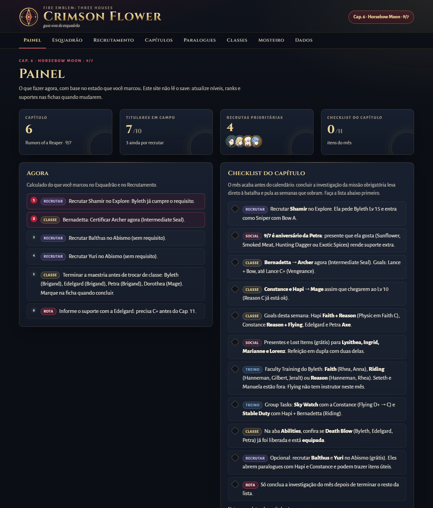
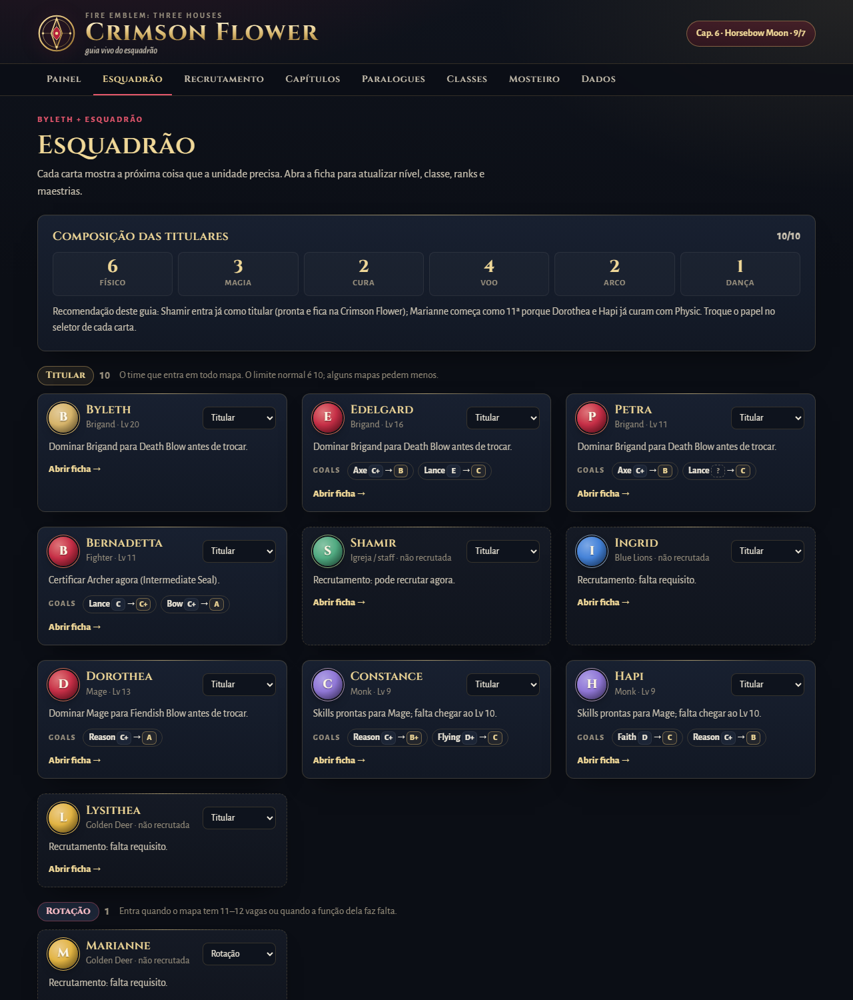
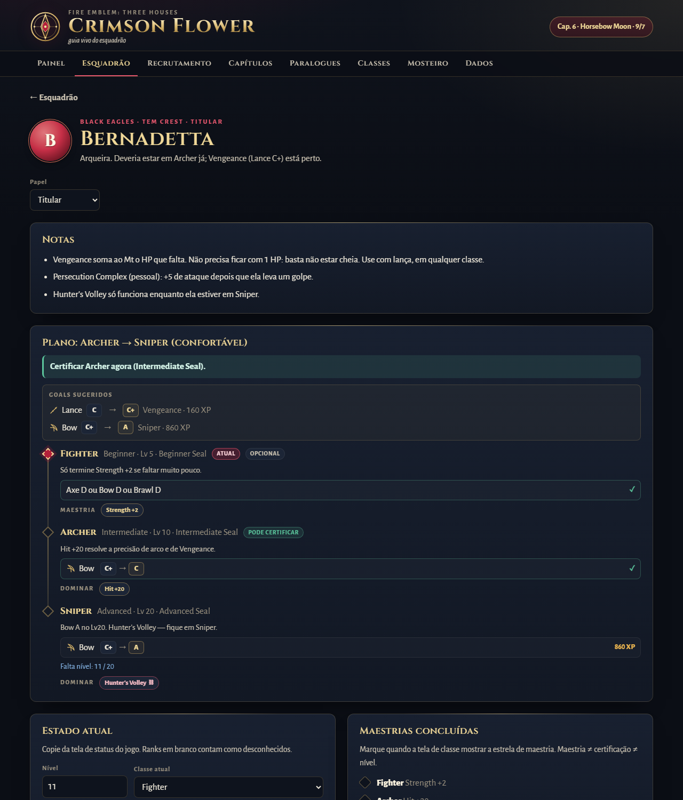
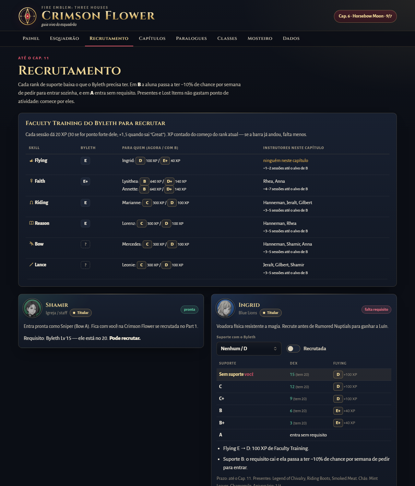
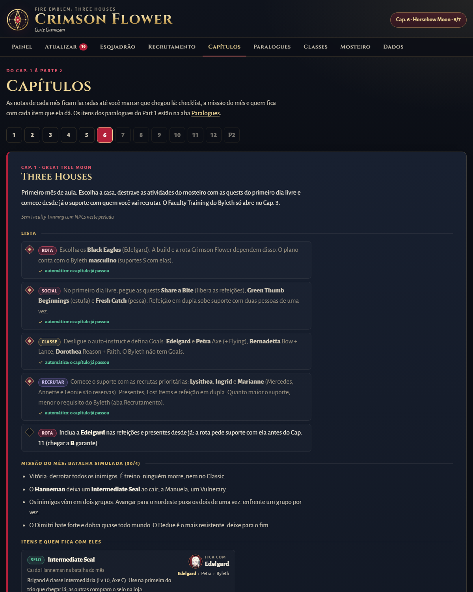
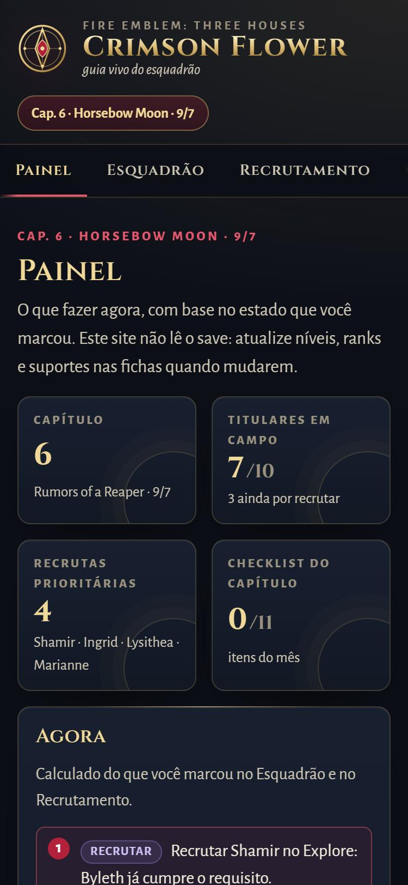
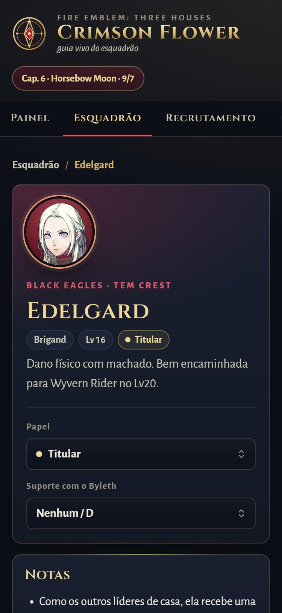
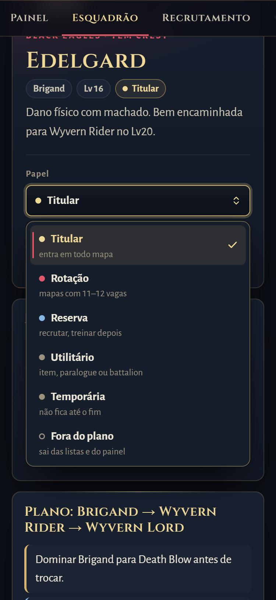

<h1 align="center">Crimson Flower — Guia vivo</h1>

<p align="center">
  Um guia visual para uma campanha <i>Fire Emblem: Three Houses</i> na rota da Edelgard:<br>
  quem recrutar, que classe certificar, que Goals pôr e o que fazer neste capítulo — sem spoilers do que vem depois.
</p>

<p align="center">
  <a href="https://ldallacqua.github.io/three-houses-crimson-build/"></a>
  
  
  
</p>

<p align="center">
  <a href="https://ldallacqua.github.io/three-houses-crimson-build/"></a>
</p>

## O que ele faz

Guias dizem a build ideal. Não sabem em que ponto o seu save está. Este guia sabe — porque você conta para ele.

O jogo roda no Switch e o save não dá para ler, então o estado é digitado: nível, classe, ranks de skill, maestrias e suporte com cada recruta, copiados da tela de status. A partir disso a página calcula o resto e atualiza na hora.

- **O que fazer agora.** Recrutar quem já cumpre o requisito, certificar quem já pode, terminar a maestria antes de trocar, os paralogues que fecham neste capítulo.
- **Atualizar, uma vez por capítulo.** Uma página com o exército e as recrutas, só com os campos que as recomendações usam (nível, classe, maestria, os ranks que o plano ainda pede, suportes). Mexer numa personagem marca ela como conferida; ao avançar de capítulo, todas voltam a pendentes e o painel avisa.
- **Goals para cada aluna.** As duas skills que mais aproximam a próxima classe do plano — ou o breakpoint que vale mais (Vengeance da Bernadetta, Physic da Hapi), com o XP que falta.
- **Recrutamento com a conta feita.** Para cada recruta, o que o Byleth precisa em cada rank de suporte (nenhum, C, C+, B, B+, A — o C+ e o B+ o jogo não mostra), o que ele já tem e quantas sessões de Faculty Training faltam — e quem ensina essa skill **neste capítulo** (no Cap. 6, por exemplo, ninguém ensina Flying).
- **Plano de classe por unidade.** Cada etapa com requisitos, nível, selo, maestria e se ela já pode certificar. Dá para trocar de plano (Sniper ou Bow Knight, Dancer ou maga) e o resto se ajusta.
- **Paralogues e prazos.** Janela, quem abre, a recompensa que importa e quem precisa estar recrutada para ela vir.
- **Notas por capítulo, lacradas.** Do Cap. 6 em diante, um caderno por mês com checklist, a missão do mês e avisos de coisas perdíveis. Itens que o estado já resolve (quem entrou, classe, maestria, suporte, paralogue feito, data passada) se marcam sozinhos e dizem por quê.
- **Mosteiro.** Quem dá Faculty Training este mês, Group Tasks que combinam com o plano, quem gosta de qual presente e chá, aniversários.
- **Resumo para o chat.** Um botão copia o estado inteiro em Markdown, para revisar o plano numa conversa ou atualizar o [guia mestre](docs/guia-mestre.md).
- **No celular, offline.** Instalável como app; abre sem internet ao lado do console.

## Interface

Cada unidade aparece com o retrato do jogo num anel na cor da casa; quem ainda não foi recrutada fica em cinza. Os controles são componentes próprios, sem biblioteca:

- **Selects** no lugar do `<select>` nativo: lista com dicas por opção, grupos (as classes vêm separadas por tier), busca por letra e navegação completa pelo teclado, seguindo o padrão *select-only combobox* da WAI-ARIA. A lista abre para cima quando falta espaço embaixo.
- **Switches** para "recrutada" e "concluído", **− / +** para o nível e losangos como marcadores de checklist.
- **Tooltips** que funcionam também no toque (as artes e habilidades explicam o que fazem) e **diálogos** de confirmação no estilo da página, em vez do `confirm()` do navegador.

## Telas

<p align="center">
  
</p>

<p align="center">
  
</p>

<p align="center">
  
</p>

<p align="center">
  
</p>

<p align="center">
  
  
  
</p>

## Sem spoilers por construção

- As notas de cada capítulo ficam em `data/chapters.js`, **lacradas em base64**: navegar pelo repositório, ler um diff ou buscar texto não mostra um mês que você ainda não jogou. A página só abre as notas até o capítulo marcado, e avançar pede confirmação.
- Quem ensina o quê em cada mês também está nas notas lacradas — as ausências de instrutores dizem muito sobre a história.
- O único aviso de rota (como não perder a Crimson Flower) está no Cap. 11, e a escolha em batalha fica num bloco fechado marcado como spoiler leve.
- Fatos de Part 2 (paralogues, decisões de classe) só aparecem quando você marca que chegou lá.

## De onde vêm os dados

Requisitos de classe e de recrutamento, magias e artes por rank, presentes, chás, aniversários, janelas de paralogue e disponibilidade de instrutores foram conferidos em [fe3h.com](https://www.fe3h.com), [Serenes Forest](https://serenesforest.net/three-houses/) e na [Fire Emblem Wiki](https://fireemblemwiki.org). Os planos de build e as prioridades são recomendação deste guia — estão marcados como tal no [guia mestre](docs/guia-mestre.md), junto com o que ainda é incerto.

Os testes (`node --test`) checam que cada classe citada num plano existe, que todo personagem na página tem retrato, que os ranks são válidos, que as tabelas de recrutamento ficam mais fáceis a cada rank de suporte, que as notas lacradas abrem e citam instrutores reais, que o cache offline lista todos os arquivos e que o estado importado é limpo antes de entrar. Um teste de fuzz (`test/fuzz.test.mjs`) renderiza todas as telas com centenas de estados aleatórios (semente fixa) e falha se alguma mostrar uma seta de rank que não sobe, `undefined`/`NaN`, ids repetidos ou rótulos apontando para campos que não existem, ou se algum conselho apontar para trás (Goal já cumprido, classe já passada, recrutar quem já entrou).

## Rodar localmente

Precisa de [Node.js](https://nodejs.org/) 20 ou mais novo. Não há nada para instalar.

```bash
git clone https://github.com/ldallacqua/three-houses-crimson-build.git
cd three-houses-crimson-build
node tools/serve.mjs
```

Abre em http://localhost:8790. Testes: `node --test`.

Para editar as notas dos capítulos: `node tools/seal.mjs open` abre os arquivos em `notes/chapters/` (fora do git); depois de editar, `node tools/seal.mjs` valida e lacra de novo. Uma tarefa pode ter `auto` (regras em `taskAuto`, `js/logic.js`: `recruited`, `recruits`, `reached`, `mastered`, `support`, `paralogues`, `after`) para se marcar sozinha; o lacre recusa nomes que não existem.

Para refazer ou acrescentar retratos (precisa de `curl` e `ffmpeg`): `bash tools/portraits.sh petra hapi`. Um personagem novo também entra na lista `PORTRAITS` do `sw.js`.

Chás, assuntos do chá, respostas do comentário final, pratos e presentes vêm do fe3h.com: `node tools/social.mjs` refaz `data/social.js`. Os comentários finais não são publicados (são falas do jogo); `data/tea-gists.js` traz um resumo em português de cada um, na mesma ordem, e os testes avisam se a contagem mudar.

## O que tem no repositório

| Caminho | O que é |
|---|---|
| `index.html`, `css/styles.css` | A página. O visual é CSS e SVG desenhados à mão; a única arte do jogo são os retratos. |
| `js/controls/` | Select, tooltip e diálogo, e o posicionamento das listas flutuantes. |
| `img/portraits/` | Retratos dos personagens (WebP, 224 px), gerados por `tools/portraits.sh`. |
| `js/logic.js` | As contas: requisitos de classe, plano por unidade, Goals, recrutamento, treino do Byleth, paralogues, próximos passos. Funções puras. |
| `js/store.js` | Estado no `localStorage`, exportar/importar JSON e a limpeza de tudo que entra. |
| `js/views/` | Uma tela por arquivo, renderizada com um template que escapa tudo. |
| `data/` | Classes, unidades, instrutores, paralogues, chás e pratos (`social.js`, gerado), o snapshot inicial e as notas lacradas. |
| `docs/guia-mestre.md` | O guia mestre em texto, com histórico de versões. |
| `sw.js`, `manifest.webmanifest` | Cópia offline e instalação como app. |
| `test/` | Testes com o runner do próprio Node. |
| `tools/` | Servidor local, lacre das notas, retratos, dados de chá e pratos, e screenshots. |

Sem framework, sem pacotes, sem etapa de build: o GitHub Actions roda os testes e publica a pasta como está no GitHub Pages.

---

Guia de fã, sem afiliação com Nintendo, Intelligent Systems ou Koei Tecmo. Os retratos dos personagens são © Nintendo / Intelligent Systems / Koei Tecmo Games, obtidos na [Fire Emblem Wiki](https://fireemblemwiki.org/) e usados aqui sem fins comerciais.
